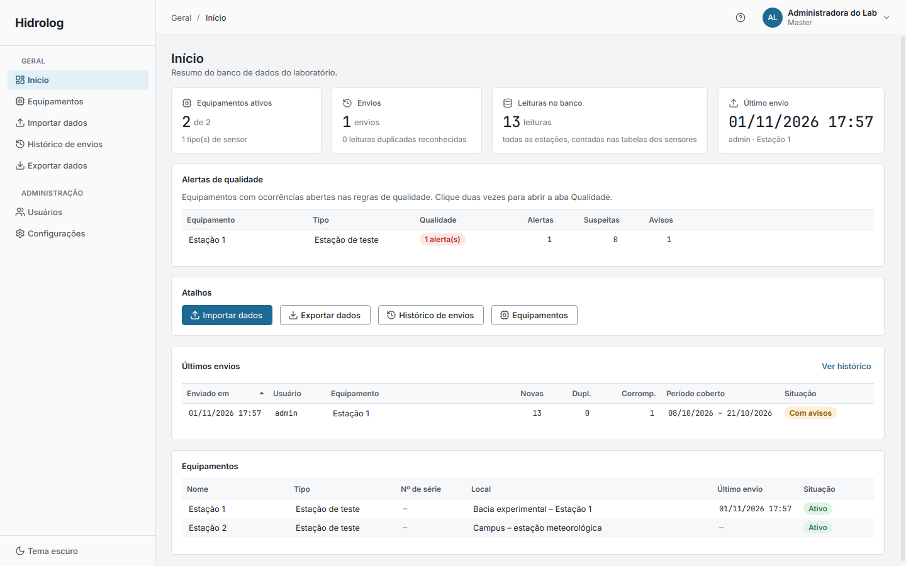
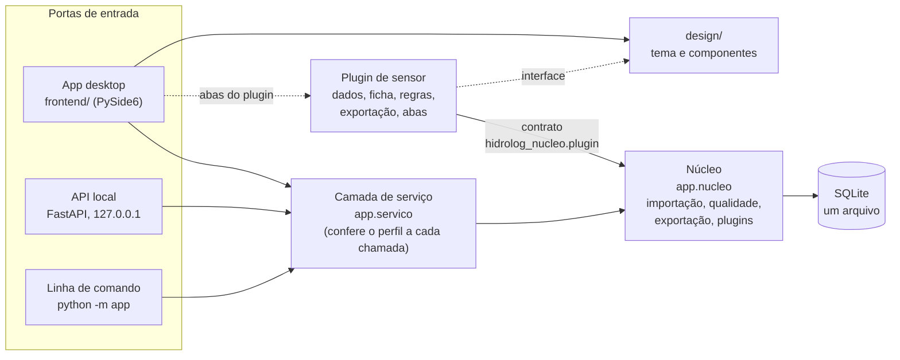

<h1 align="center">Hidrolog</h1>

<p align="center">
App desktop para laboratórios <b>cadastrarem, importarem, consultarem e exportarem dados de sensores
ambientais</b>. Cada tipo de sensor entra por um plugin.
</p>

<p align="center">
  
  
  
  
  
  
  
  
</p>

## 🚀 Quick start 

Pré-requisitos: Python ≥ 3.10. No Linux, o Qt precisa da biblioteca `libxcb-cursor0`
(`sudo apt install libxcb-cursor0`). Os comandos abaixo são para Linux e macOS; no Windows, use
`venv\Scripts\python` no lugar de `venv/bin/python` e `set HIDROLOG_DADOS_DIR=...` no lugar de
`export`.

```bash
git clone <url-do-repositorio> hidrolog
cd hidrolog/frontend
python3 -m venv venv
venv/bin/pip install -r requirements.txt        # o app, o backend e o design, em modo editável

export HIDROLOG_DADOS_DIR=/tmp/hidrolog-teste   # um banco só para o teste (não toca no seu)
venv/bin/python -m app criar-master --login admin --nome "Admin"   # pede a senha duas vezes
venv/bin/python -m hidrolog                     # abre o app (--tema escuro, se preferir)
```

Dentro do app, para ver o fluxo completo com o plugin de exemplo deste repositório:

1. Entre com `admin` e a senha que você criou.
2. **Configurações → Plugins → Importar plugin → Do computador** e escolha a pasta
   `exemplos/plugin-termometro`. Confira o que vai entrar, digite a senha e **reinicie o app**
   (feche e rode `venv/bin/python -m hidrolog` de novo, com o mesmo `HIDROLOG_DADOS_DIR`).
3. **Equipamentos → Novo equipamento**, tipo "Termômetro de exemplo".
4. **Importar dados**: escolha o equipamento e a pasta
   `exemplos/plugin-termometro/hidrolog_termometro/amostra` (um dia de leituras, com uma
   suspeita de propósito).
5. Abra o equipamento (duas vezes na lista): a aba do plugin com o gráfico, a aba
   **Qualidade** com a ocorrência, **Envios**, **Exportar**. O botão **?** no alto abre a
   Central de ajuda.

Para apagar tudo do teste: `rm -rf /tmp/hidrolog-teste`.

## Visão geral

O Hidrolog organiza num banco de dados único, no próprio computador do laboratório, as leituras
dos sensores ambientais que a equipe mantém em campo: pluviômetros, disdrômetros, estações,
sondas ou qualquer aparelho que grave arquivos. Em vez de pastas de cartões SD espalhadas e
planilhas montadas à mão, cada aparelho é cadastrado como um equipamento, os arquivos dele são
importados de uma vez (uma pasta, um `.zip` ou um `.rar`, sem duplicar o que já foi importado) e
os dados passam a ser consultados por período, com gráficos e tabelas, e exportados nos formatos
que a análise pede. A cada importação, as regras de qualidade do plugin conferem as leituras e
apontam o que merece atenção (valores impossíveis, lacunas, sensor parado, bateria fraca), sem
nunca alterar os dados.

É feito para laboratórios de pesquisa e grupos de monitoramento que querem ter os próprios dados
sob controle, sem servidor, sem internet e sem mensalidade: roda num computador só e guarda tudo
num arquivo SQLite. Cada pessoa da equipe tem o próprio usuário, com um de três perfis:
**leitura** (consulta e exporta), **cadastro** (cadastra equipamentos, importa dados e trata a
qualidade) e **master** (administra usuários e plugins). Como cada tipo de sensor é um plugin,
um laboratório instala só os aparelhos que usa, e um sensor novo entra sem mexer no núcleo do
app. O nome e as logos do laboratório e da instituição vêm de uma pasta de marca da instalação,
então o mesmo código serve a qualquer grupo.



## Estrutura do repositório

```
hidrolog/
├── backend/      núcleo sem interface: banco, usuários, importação, qualidade, exportação, plugins
│   ├── app/                pacote "app": a camada de serviço que o app chama
│   ├── hidrolog_nucleo/    o contrato dos plugins (a única parte que um plugin importa)
│   └── tests/              testes, com um sensor fictício e dados sintéticos
├── frontend/     o app desktop (PySide6), pacote "hidrolog"
├── design/       tema, componentes de interface e o catálogo deles, pacote "design"
├── exemplos/
│   └── plugin-termometro/  um plugin de sensor completo e pequeno, com o guia de criação
├── scripts/      testar.sh: roda todos os testes
└── img/          capturas usadas neste README
```

### Arquitetura

- **`backend/`** é o coração e não depende de interface. `app/servico.py` é a porta de entrada:
  cada função recebe o usuário logado, confere o perfil no banco e faz o trabalho
  (cadastrar, importar, consultar, exportar, administrar). Por baixo, `app/nucleo/` cuida do banco
  (SQLAlchemy + Alembic, com migrações separadas para o núcleo e para cada plugin), da abertura de
  pastas, `.zip` e `.rar`, da gravação em lotes sem duplicar, das regras de qualidade, do
  gerenciador de plugins e da auditoria. `hidrolog_nucleo/plugin.py` é o **contrato**: as classes
  que um plugin usa para declarar o que sabe fazer. A API FastAPI (`app/api/`) e a linha de comando
  (`python -m app ...`) são cascas finas sobre o mesmo serviço.
- **`frontend/`** é o app que as pessoas usam. Ele chama `app.servico` direto, no mesmo processo,
  sem HTTP; o trabalho pesado (abrir o banco, entrar, importar, exportar) roda em segundo plano
  com indicador de carregamento. O núcleo da interface (`hidrolog/nucleo/`) não conhece nenhum
  sensor: a página de cada equipamento junta as abas comuns (Qualidade, Envios, Importar,
  Exportar, Cadastro) às abas que o plugin do tipo oferece. Os textos da Central de ajuda são
  arquivos Markdown em `hidrolog/ajuda/topicos/`.
- **`design/`** é o sistema visual: cores, fontes, ícones, o estilo dos gráficos e os componentes
  (tabelas, cartões, formulários, mapa, diálogos, carregamento). O frontend e as abas dos plugins
  usam os mesmos componentes, então um sensor novo já nasce com a cara do app.
- **`exemplos/plugin-termometro/`** é o modelo para quem vai escrever um plugin (ver
  [Plugins](#plugins)). Os testes também o usam como plugin instalável.



## Plugins

### Funcionamento dos plugins

Tudo o que é específico de um tipo de sensor fica no plugin: um pacote Python com um manifesto
(`hidrolog-plugin.toml`) e um objeto `PLUGIN` que declara a tabela das leituras e as migrações
dela, como reconhecer e ler os arquivos do aparelho, os campos que o cadastro do equipamento pede,
as regras de qualidade, as consultas, os formatos de exportação e as abas da página do
equipamento. O núcleo faz o resto: abre os envios, grava em lotes sem duplicar, roda as regras,
registra o envio, aplica as migrações (com cópia de segurança do banco antes) e monta a página.

O app encontra os plugins de dois jeitos: pelo **gerenciador de plugins** (Configurações → Plugins,
só o master, com senha), que instala a partir de uma pasta, de um `.zip` ou de um repositório do
GitHub, e, em desenvolvimento, por **entry point** de um pacote instalado com `pip install -e`.
Toda mudança de plugin vale ao reiniciar o app. Desativar ou remover um plugin nunca apaga dados:
os equipamentos dele ficam com as abas comuns e a exportação genérica, e só a importação fica
indisponível até o plugin voltar.

### 🚀 Quick start: crie seu plugin

O plugin de [`exemplos/plugin-termometro`](exemplos/plugin-termometro/) é um termômetro que grava
um CSV com `data_hora;temperatura_c`, com tudo o que um plugin pode ter no menor tamanho.

1. **Copie** a pasta para um repositório novo, ao lado do Hidrolog:
   `cp -r hidrolog/exemplos/plugin-termometro hidrolog-plugin-pluviometro`.
2. **Renomeie**: no `hidrolog-plugin.toml`, troque `codigo`, `nome`, `modulo` e `tabelas`; renomeie
   a pasta `hidrolog_termometro` para o módulo novo e ajuste a tabela, a migração
   (`migracoes/`) e o entry point do `pyproject.toml`.
3. **Ensine a ler os seus arquivos**: em `dados.py`, `reconhecer` decide, só pelos nomes, se um
   envio é do seu sensor e `ler` devolve uma leitura por vez. Troque a `amostra/` por arquivos
   reais do aparelho.
4. **Complete** o que fizer sentido: campos do cadastro (`ficha.py`), regras de qualidade
   (`regras.py`), exportação (`dados.py`) e as abas (`interface.py`).
5. **Teste** contra o contrato, de dentro da pasta do plugin:
   `../hidrolog/frontend/venv/bin/python -m pytest --plugin=<codigo>`. O kit de conformidade
   confere o manifesto, as migrações, a importação da amostra, a reimportação sem duplicar, a
   ficha, as regras, a exportação e as abas.
6. **Instale** pelo gerenciador do app (pasta ou `.zip`) e reinicie.

O passo a passo completo, com código, está em
[`COMO-CRIAR-UM-PLUGIN.md`](exemplos/plugin-termometro/COMO-CRIAR-UM-PLUGIN.md).

## Marca da instalação

Sem configuração, o app é genérico: o nome é só "Hidrolog" e o lugar das logos mostra o texto
**LOGO**. Cada laboratório põe a própria identidade numa pasta de marca, fora do repositório
(`~/.local/share/Hidrolog/marca/` no Linux, ou `HIDROLOG_MARCA_DIR`):

```
marca/
├── marca.toml        nomes e siglas do laboratório e da instituição, cores, posição inicial do mapa
├── logo.svg|png      logo do laboratório (e, opcional, logo-escura.svg|png para o tema escuro)
└── instituicao.svg|png   logo da instituição (opcional)
```

Formato completo em [`design/README.md`](design/README.md#marca-da-instalação).

## Armazenamento dos dados

O banco, o log e as preferências ficam na pasta de dados do usuário:
`~/.local/share/Hidrolog/` (Linux), `%LOCALAPPDATA%\Hidrolog` (Windows) ou
`~/Library/Application Support/Hidrolog` (macOS). A variável `HIDROLOG_DADOS_DIR` troca a pasta.
Importar `.rar` compactado precisa de um descompactador no sistema (`sudo apt install unar`).

## Testes

```bash
cd backend && python3 -m venv venv && venv/bin/pip install -r requirements.txt && cd ..
scripts/testar.sh                 # backend e frontend (usa os venvs de backend/ e frontend/)
```

Os testes usam bancos temporários, um sensor fictício de `backend/tests/` e o plugin de exemplo,
e não precisam de tela, de internet nem de nenhum plugin real.

## Documentação

- [`backend/README.md`](backend/README.md): camada de serviço, banco, importação, qualidade, API e linha de comando.
- [`frontend/README.md`](frontend/README.md): telas, perfis, abas dos plugins, testes e ferramenta ponta a ponta.
- [`design/README.md`](design/README.md): guia de design, tema, componentes e marca.
- [`exemplos/plugin-termometro/README.md`](exemplos/plugin-termometro/README.md): o plugin de exemplo, arquivo por arquivo.
- [`exemplos/plugin-termometro/COMO-CRIAR-UM-PLUGIN.md`](exemplos/plugin-termometro/COMO-CRIAR-UM-PLUGIN.md): como criar um plugin.


## Licença

Ainda sem licença definida: todos os direitos reservados. Para usar ou adaptar o código, entre em
contato.
