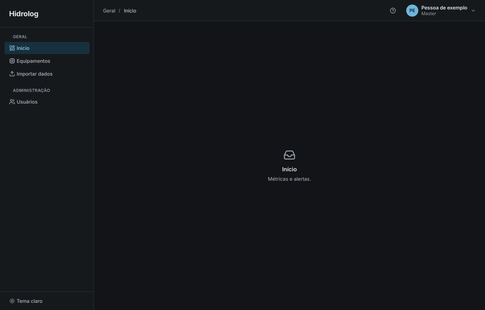
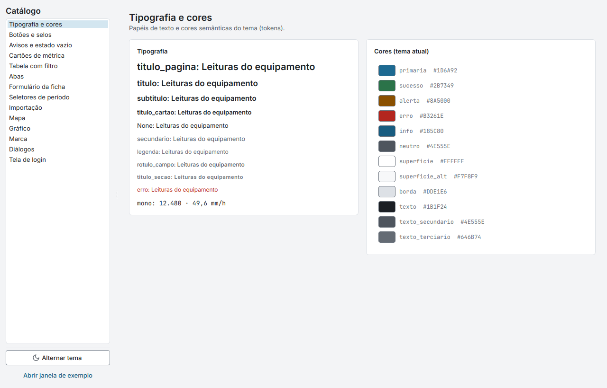
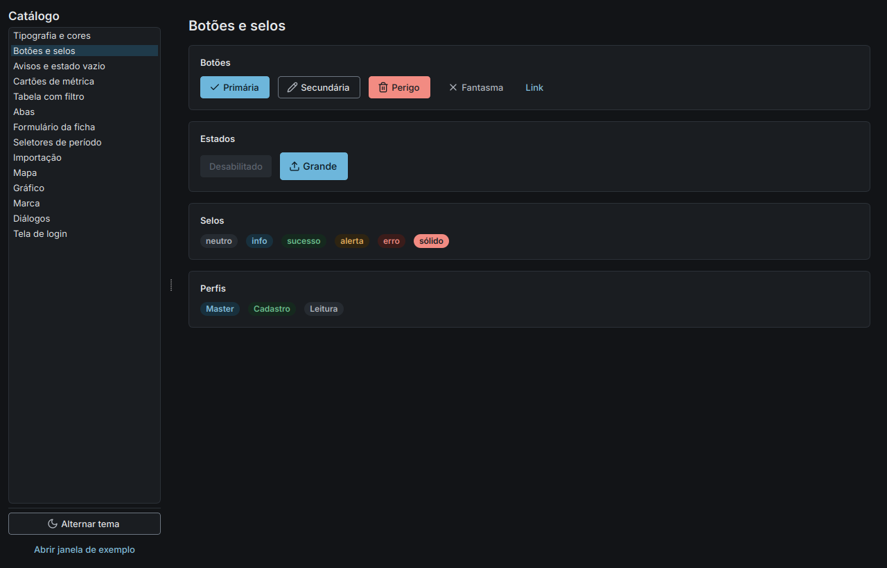
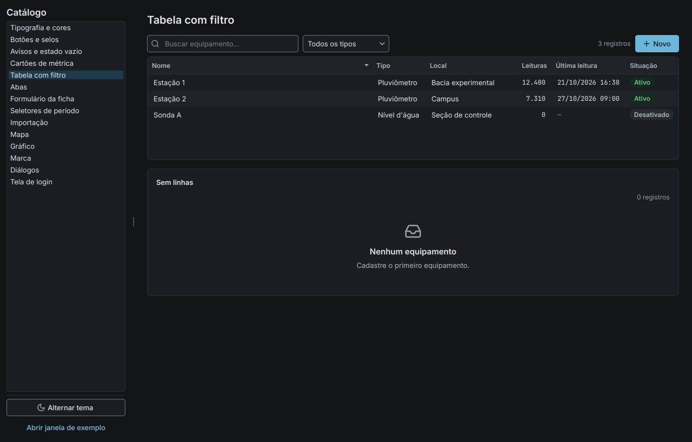
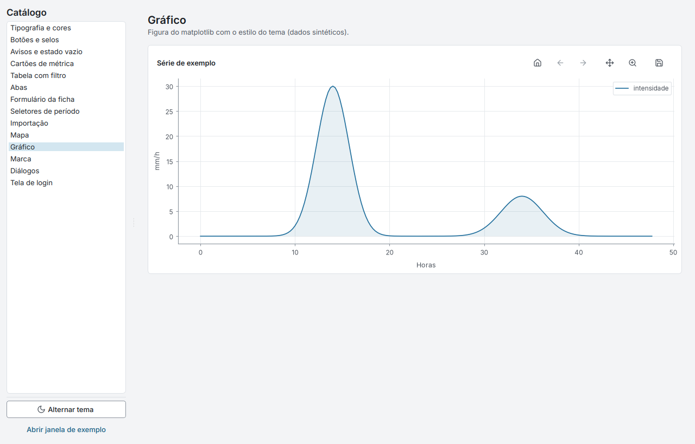
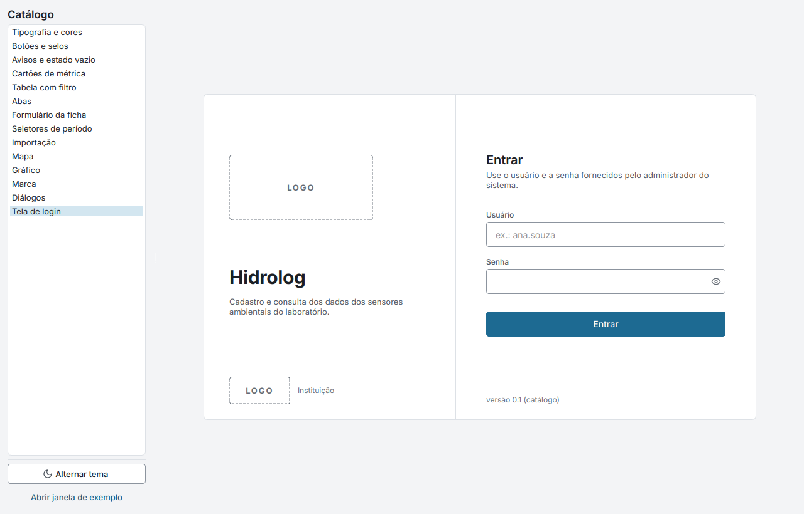

# design

O design é o sistema visual do Hidrolog: as cores, as fontes, os ícones, o estilo dos gráficos e
os componentes de interface com que todas as telas são montadas. Ele é um pacote Python
(`design`) feito em PySide6 e não sabe nada sobre sensores, usuários ou banco de dados: um
componente daqui mostra uma tabela, um cartão ou um formulário com os dados que receber, sem
saber de onde eles vêm. Assim o mesmo visual serve ao app e às abas de qualquer plugin.

Esta pasta também é o lugar das decisões de aparência. Nenhuma tela do app escreve uma cor ou um
tamanho direto no código: tudo sai de um arquivo de tokens, e mudar um token muda o app inteiro,
nos dois temas. A pasta traz ainda um catálogo executável que mostra cada componente isolado, e é
de lá que vêm as imagens deste guia.



## Estrutura

```
design/
├── tema/                 a identidade visual
│   ├── tokens.py         cores, fontes, espaços, raios e dimensões (a fonte única de tudo)
│   ├── aplicacao.py      aplicar_tema(): fontes, paleta do Qt, folha de estilo, ícones
│   ├── qss.py            gera a folha de estilo (QSS) a partir dos tokens
│   ├── graficos.py       o estilo do matplotlib e harmonizar_figura()
│   ├── marca.py          a identidade da instalação (nome, laboratório, logos, cor)
│   ├── contraste.py      confere o contraste de todos os pares de cor (WCAG)
│   └── fontes/           Inter e JetBrains Mono, com as licenças
├── componentes/          os widgets reutilizáveis, um assunto por arquivo
├── assets/icones/        ícones Lucide (SVG), com a licença
├── catalogo.py           catálogo de componentes e gerador das capturas
├── gerar_logo_escura.py  cria a versão da logo para o tema escuro
└── img/                  capturas usadas neste README
```

A pasta **`tema/`** define e aplica a aparência. `tokens.py` guarda, com nomes pelo papel e não
pela cor (`superficie`, `texto_secundario`, `primaria`, `erro`), os valores de cada tema;
`qss.py` transforma esses tokens na folha de estilo do Qt; `aplicacao.py` junta tudo em
`aplicar_tema(app, "claro" | "escuro")`, que registra as fontes, aplica o estilo e avisa os
componentes quando o tema muda. `marca.py` cuida da identidade de cada instalação e `graficos.py`
faz os gráficos do matplotlib combinarem com o resto.

A pasta **`componentes/`** reúne os blocos de montagem das telas, todos sem nada específico de
sensor: a janela principal com barra lateral e cabeçalho (`shell.py`), páginas, cartões, botões e
rótulos (`base.py`), abas, tabelas com busca e filtros, cartões de métrica, selos, estados vazios,
faixas de aviso, o formulário gerado de uma ficha, seletores de período, a área de soltar arquivos
e o painel de importação, o mapa, a figura do matplotlib, as logos, os diálogos, o login, a tela de
abertura, os indicadores de carregamento, o menu do usuário e as funções de formatação em pt-BR.

## Funcionamento

### Tokens e temas

Cada decisão visual é um token. As cores têm uma versão clara e uma escura com o mesmo nome; os
tamanhos de fonte, os espaços (uma grade de 4 px), os raios e as alturas dos controles são os mesmos
nos dois temas. Uma tela pede `cor("texto_secundario")` ou usa o papel `secundario` num rótulo, e
recebe o valor certo para o tema atual. Trocar de tema chama `aplicar_tema` de novo: a folha de
estilo é regerada, e os componentes que desenham por conta própria (ícones, gráficos, o avatar, o
indicador de carregamento) escutam o aviso `tema_alterado` e se redesenham sozinhos.

Todos os pares de cor usados foram conferidos pelo `tema/contraste.py` contra as regras de
acessibilidade WCAG 2.1 (texto com contraste de pelo menos 4,5:1, bordas, foco e séries de gráfico
com pelo menos 3:1), nos dois temas. O script sai com erro se algum par falhar, então dá para
rodá-lo depois de qualquer mudança de cor.



### Princípios

A interface é pensada como um painel de laboratório, não como vitrine: fundo neutro, uma única cor
de ação, sem gradientes nem animações, e o destaque vai para os dados. Números aparecem em fonte
monoespaçada, alinhados à direita e com separadores brasileiros (`10.954`, `72,1`), sempre com a
unidade, e a ausência de valor é um traço, nunca zero. Datas seguem o formato `dd/mm/aaaa hh:mm`,
pelas funções de `componentes/formatos.py`. O que um perfil não pode fazer é escondido, e o que
ainda não dá para fazer (como importar sem ter escolhido um arquivo) fica desabilitado. A cor nunca
é o único sinal: todo selo tem texto e toda faixa de aviso tem ícone e frase.

As mensagens seguem o mesmo cuidado. Um erro diz o que aconteceu e o que fazer, sem culpar e sem
jargão. Uma confirmação é uma pergunta com o objeto ("Desativar Ana Souza?"), explica a
consequência e se dá para desfazer, e os botões usam o verbo da ação; nas ações destrutivas o botão
é vermelho e o foco começa em Cancelar, para que um Enter distraído não apague nada.



### Fontes e ícones

O app usa duas fontes embarcadas, que não dependem do que está instalado no computador: **Inter**
para a interface e **JetBrains Mono NL** para números, datas e caminhos (a variante sem ligaduras,
para que `->` e `>=` nos dados não virem símbolos). Ambas estão em `tema/fontes/`, com a licença
OFL. Os ícones são do **Lucide** (licença ISC), em SVG com traço de 2 px; a função
`icone(nome, token)` recolore cada ícone pela cor do tema e o desenha em resolução dobrada para
telas de alta densidade. Para usar um ícone novo, basta copiar o SVG dele para `assets/icones/`.

### Componentes

A janela principal (`JanelaPrincipal`) é o esqueleto do app: barra lateral com seções e páginas,
cabeçalho com o caminho da página, botão de ajuda e menu do usuário, e a área das páginas, criadas
só na primeira visita. Cada página (`Pagina`) tem título, subtítulo, ações no canto e um corpo com
rolagem. Os componentes de dados são os mais usados: `TabelaFiltravel` recebe colunas tipadas
(texto, número, data, selo) e uma lista de dicionários, e já traz busca, filtros, ordenação,
contagem e um estado vazio com ícone e explicação; `CartaoMetrica` mostra um valor grande com
unidade; `Selo` marca situações com um tom semântico.



Alguns componentes existem justamente para o Hidrolog ser extensível. `FormularioFicha` gera um
formulário inteiro a partir da ficha que um plugin declara (texto, número, data, escolha, campos
só de leitura) e mostra os erros de validação no campo certo. `Abas` cria cada aba só quando ela é
aberta, o que deixa a página do equipamento leve mesmo com muitas abas de plugin.
`AreaSoltarArquivo` aceita arrastar e soltar ou um único botão que escolhe pasta ou arquivo.
`MapaSeletor` desenha o mapa do OpenStreetMap com o próprio Qt, sem navegador embutido, com cache
dos ladrilhos e aviso quando não há internet. `IndicadorCarregamento`, `Carregando` e
`SobreposicaoCarregamento` dão o retorno visual de tudo o que demora.

### Gráficos

Os gráficos dos plugins são feitos com matplotlib e ficam com a cara do app sem mudar o código que
os desenha. `aplicar_tema` ajusta o matplotlib para usar a Inter, o ciclo de cores da paleta (com
azul e laranja primeiro, o par mais seguro para daltonismo), uma grade discreta e datas em
`dd/mm`. Como muitas bibliotecas usam cores fixas que esse ajuste não alcança, `harmonizar_figura`
recolore uma figura já pronta, trocando cada cor fixa pelo papel equivalente da paleta; o
componente `FiguraIncorporada` faz isso sozinho e troca o tema da figura sem recalcular nada. Os
mesmos parâmetros estão em `tema/graficos-claro.mplstyle` e `graficos-escuro.mplstyle`, para quem
quiser o mesmo visual em scripts fora do app.



### Marca da instalação

O pacote não traz nenhuma logo nem nome de laboratório. `marca.py` lê, ao abrir o app, a pasta de
marca da instalação (`marca.toml` com nomes, siglas, cor de ação e a posição inicial do mapa, e as
imagens `logo`, `logo-escura`, `instituicao` e `icone`, em SVG ou PNG). Sem essa pasta, o app se
chama só "Hidrolog" e cada lugar de logo mostra o texto **LOGO** num quadro tracejado. A cor de ação
da marca troca apenas os tokens de marca (botão principal, foco, seleção, item ativo); superfícies,
textos, estados e cores de gráfico não mudam, para que o contraste conferido continue valendo. Para
logos com letreiro escuro, que somem no tema escuro, `gerar_logo_escura.py` cria uma versão clara do
letreiro mantendo as partes coloridas.

A pasta fica em `<pasta de dados do app>/marca/` (no Linux, `~/.local/share/Hidrolog/marca/`) ou no
caminho de `HIDROLOG_MARCA_DIR`, e todos os campos do `marca.toml` são opcionais:

```toml
nome_app = "Hidrolog"
descricao = "Cadastro e consulta dos dados dos sensores ambientais do laboratório."

[laboratorio]
sigla = "LAB"
nome = "Laboratório de …"

[instituicao]
sigla = "UNIV"
nome = "Universidade …"

[mapa]
posicao_inicial = [-15.7939, -47.8828]   # latitude, longitude (padrão: centro do Brasil)

[cores]                                  # cor de ação; confira o contraste com tema/contraste.py
primaria_claro = "#1D6A92"
primaria_escuro = "#6DB6DB"
```



## Integração com o sistema

O frontend chama `aplicar_tema(app, modo)` ao abrir e monta todas as telas com os componentes
daqui. Os plugins usam o mesmo pacote nas suas abas: importam de `design.componentes` (tabelas,
figuras, cartões, estados vazios) e de `design.tema` (cores, ícones, espaços), e com isso um sensor
novo já nasce com a cara do app e acompanha a troca de tema. O backend usa apenas a leitura da
pasta de marca, para colocar o nome da instituição nos metadados das exportações.

```python
from PySide6.QtWidgets import QApplication
from design.tema import aplicar_tema
from design.componentes import Cartao, TabelaFiltravel, Coluna

app = QApplication([])
aplicar_tema(app, "claro")
tabela = TabelaFiltravel([Coluna("tempo", "Tempo", "data_hora"), Coluna("chuva", "Chuva (mm/h)", "numero")])
tabela.definir_linhas([{"tempo": ..., "chuva": 1.2}])
```

## Execução e testes

```bash
cd design
python3 -m venv venv && venv/bin/pip install -e .
venv/bin/python catalogo.py                                        # o catálogo, no tema claro
venv/bin/python catalogo.py --tema escuro
QT_QPA_PLATFORM=offscreen venv/bin/python catalogo.py --capturas   # uma captura por seção, em capturas/
venv/bin/python tema/contraste.py                                  # confere o contraste das cores
```

O catálogo mostra cada componente isolado, com dados fictícios, numa janela com a lista de seções,
um botão que alterna o tema e uma janela de exemplo com barra lateral e cabeçalho. Os testes do
frontend abrem o catálogo inteiro sem tela, para garantir que nenhum componente quebra.

## Referência

**Cores principais** (claro / escuro):

| Token | Claro | Escuro | Uso |
|---|---|---|---|
| `fundo` | `#F3F4F6` | `#121417` | fundo da área de conteúdo |
| `superficie` | `#FFFFFF` | `#1A1D21` | cartões, tabelas, diálogos |
| `texto` | `#1B1F24` | `#E7E9EC` | texto principal |
| `texto_secundario` | `#4E555E` | `#B3B9C1` | descrições |
| `primaria` | `#1D6A92` | `#6DB6DB` | cor de ação (trocável pela marca) |
| `sucesso` · `alerta` · `erro` · `info` | `#2B7349` · `#8A5000` · `#B3261E` · `#185C80` | `#6CC08F` · `#E6AE5C` · `#F28B82` · `#86C3E2` | estados |

**Tipografia:** Inter 13 px no texto, 20 px / 600 no título de página, 12 px nos rótulos e
legendas; JetBrains Mono NL 12 px nas tabelas e 24 px / 500 nos cartões de métrica. **Espaços:**
2, 4, 8, 12, 16, 24, 32 e 48 px. **Raios:** 4 px em campos e botões, 6 px em cartões e tabelas.
**Alturas:** controles de 32 px, linhas de tabela de 30 px, cabeçalho de 56 px, barra lateral de
248 px de largura, e nada clicável com menos de 24 × 24 px.
