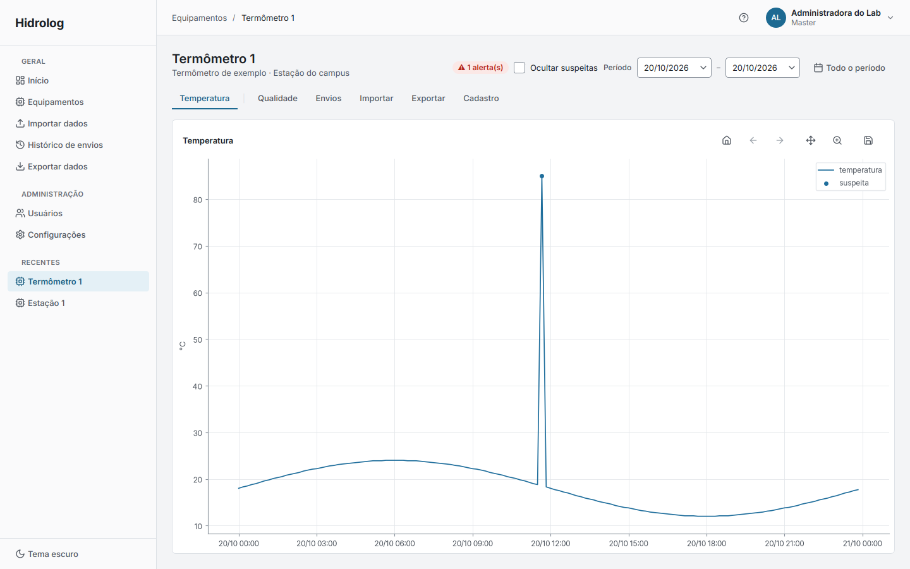

# plugin-termometro

Este é o plugin de exemplo do Hidrolog: um sensor completo, mas do menor tamanho possível, feito
para ser lido, entendido e copiado. Ele descreve um termômetro imaginário que grava um arquivo CSV
com uma leitura por linha (`data_hora;temperatura_c`), e com isso mostra, num código curto, tudo o
que um plugin de verdade declara: onde as leituras ficam no banco, como reconhecer e ler os
arquivos do aparelho, que campos o cadastro do equipamento pede, que regras de qualidade valem,
como exportar e que aba aparece na página do equipamento.

O exemplo não vem instalado no app e não aparece para quem não o importar. Ele também é usado pelos
testes do Hidrolog (como plugin instalável pelo gerenciador e no kit de conformidade), então tudo o
que está aqui funciona de verdade e continua funcionando a cada mudança do núcleo.



## Estrutura

```
plugin-termometro/
├── hidrolog-plugin.toml      o manifesto (lido sem executar código)
├── pyproject.toml            só para instalar em desenvolvimento (pip install -e)
├── COMO-CRIAR-UM-PLUGIN.md   o guia completo de como escrever um plugin
├── hidrolog_termometro/      o pacote Python do plugin
│   ├── __init__.py           junta tudo no objeto PLUGIN
│   ├── dados.py              tabela, reconhecer e ler os arquivos, consultas e exportação
│   ├── ficha.py              campos do cadastro do equipamento
│   ├── regras.py             regras de qualidade
│   ├── interface.py          a aba da página do equipamento (o único módulo com PySide6)
│   ├── migracoes/            a migração que cria a tabela do plugin
│   └── amostra/              um dia de leituras, para testar
└── img/                      capturas usadas neste README
```

O **manifesto** `hidrolog-plugin.toml` é a carteira de identidade do plugin: código (`termometro`),
nome, versão, versão do contrato do núcleo que ele usa, autor, o módulo Python que traz o plugin e,
só para mostrar na confirmação da instalação, a tabela que ele cria e os campos que ele acrescenta
ao cadastro. O gerenciador lê esse arquivo sem importar nada do plugin, então consegue mostrar o que
vai entrar e recusar um pacote incompatível antes de executar qualquer código dele.

O pacote **`hidrolog_termometro`** contém o plugin propriamente dito, e `__init__.py` monta o objeto
`PLUGIN` que o núcleo procura: ele aponta o manifesto, a tabela e as migrações, as funções de
ingestão, a ficha, as regras, o módulo de consultas, a exportação, o módulo de interface e a
amostra. Cada uma dessas partes fica num arquivo próprio, explicado a seguir.

## Funcionamento

**`dados.py`** é o coração do sensor. Ele define a tabela `termometro_leitura` (equipamento, envio,
horário e temperatura, com uma restrição de unicidade por equipamento e horário, que é o que o
núcleo usa para nunca gravar a mesma leitura duas vezes). A função `reconhecer` recebe a árvore de
arquivos de um envio, sem o conteúdo, e devolve um plano: cada `.csv` cuja primeira linha tem a
coluna `temperatura_c` vira uma unidade a ler, e todo o resto vai para os ignorados com o motivo; se
não houver nenhum, ela recusa o envio dizendo por quê. A função `ler` recebe uma unidade e devolve
as leituras uma a uma, em fluxo, para que um arquivo grande não precise caber inteiro na memória. O
mesmo arquivo traz a consulta que a aba usa (`buscar`, que confere o perfil de quem pede) e a
exportação em CSV, com a coluna de qualidade que o núcleo preenche.

**`ficha.py`** declara os campos que o formulário de cadastro do equipamento ganha quando o tipo é
"Termômetro de exemplo": o intervalo de amostragem esperado e a altura do sensor, com tipo, unidade,
limites e valor padrão. O app gera os campos sozinho e o núcleo valida os valores, devolvendo o erro
para o campo certo.

**`regras.py`** traz as duas formas de regra de qualidade. `temperatura_impossivel` é declarativa:
diz a coluna, o operador e o limite (60 °C, ajustável por equipamento), e o núcleo marca como
suspeita cada leitura acima dele. `sem_dados` é uma função, no nível do equipamento, que gera um
alerta quando a última leitura é mais antiga que alguns dias. Nenhuma das duas altera os dados: elas
só criam ocorrências.

**`interface.py`** é o único módulo que importa PySide6 e matplotlib, e só é carregado quando alguém
abre um equipamento desse tipo. Ele declara a lista `ABAS` com uma aba, "Temperatura", que recebe do
núcleo o equipamento, o período, as leituras suspeitas e o filtro "Ocultar suspeitas", busca os dados
pela consulta do plugin e desenha a série com os componentes do design, destacando as suspeitas.

**`migracoes/`** tem a migração do Alembic que cria a tabela, num ramo próprio com o código do
plugin e dependente da primeira migração do núcleo; o app a aplica sozinho ao abrir, com uma cópia
de segurança do banco antes. **`amostra/`** tem um dia de leituras a cada 10 minutos, com uma
leitura de 85 °C posta de propósito para disparar a regra de qualidade.

## Integração com o sistema

O núcleo chama este plugin pelos pontos que o `PLUGIN` declara: reconhece e lê os envios na
importação, roda as regras depois dela, pede a exportação e, no app, monta a aba. O plugin, por sua
vez, só usa o contrato público do núcleo (`hidrolog_nucleo.plugin`) e os componentes de
`design`, nunca o código interno do app, o que é a garantia de que ele continua funcionando quando o
núcleo muda por dentro.

Dentro do repositório, os testes do backend instalam esta pasta pelo gerenciador (como pasta, como
`.zip` e como se viesse do GitHub) e a passam pelo kit de conformidade; os testes do frontend e a
ferramenta ponta a ponta a usam para o fluxo completo de instalar, reiniciar, usar e desativar um
plugin. Para quem vai escrever um sensor novo, ela é o ponto de partida: o
[seção de plugins](../../README.md#plugins) do README principal resume os
passos, e o [guia completo](COMO-CRIAR-UM-PLUGIN.md) explica cada parte com código.

## Execução e testes

Para ver o exemplo funcionando, importe esta pasta pelo app (Configurações → Plugins → Importar
plugin → Do computador), reinicie e importe a pasta `hidrolog_termometro/amostra` num equipamento
do tipo "Termômetro de exemplo". Em desenvolvimento, também dá para instalá-lo no ambiente do app
com `pip install -e`, e ele passa a ser encontrado pelo entry point declarado no `pyproject.toml`.

Para conferir o plugin contra o contrato do núcleo, rode o kit de conformidade de dentro desta
pasta:

```bash
../../frontend/venv/bin/python -m pytest --plugin=termometro
```

O kit confere o manifesto, as migrações (subindo e descendo), a importação da amostra, a
reimportação sem duplicar, a ficha, as regras com e sem dados, a exportação e a aba, além de
verificar que o plugin recusa uma pasta vazia e os arquivos de outro sensor.
