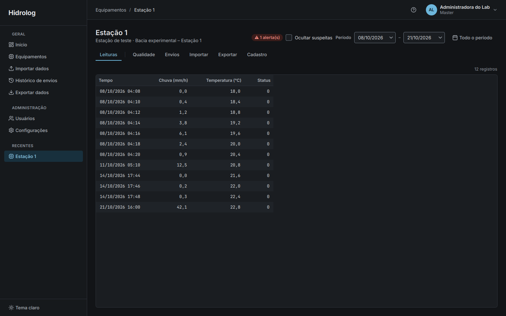
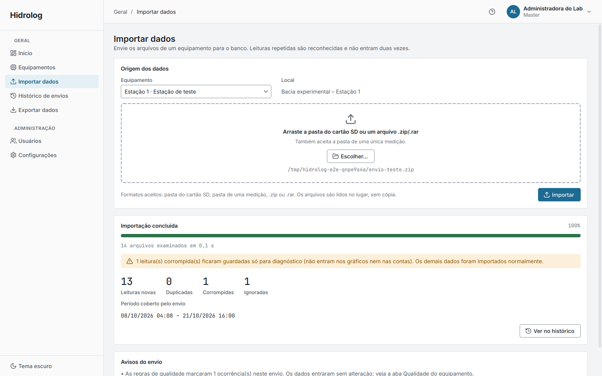
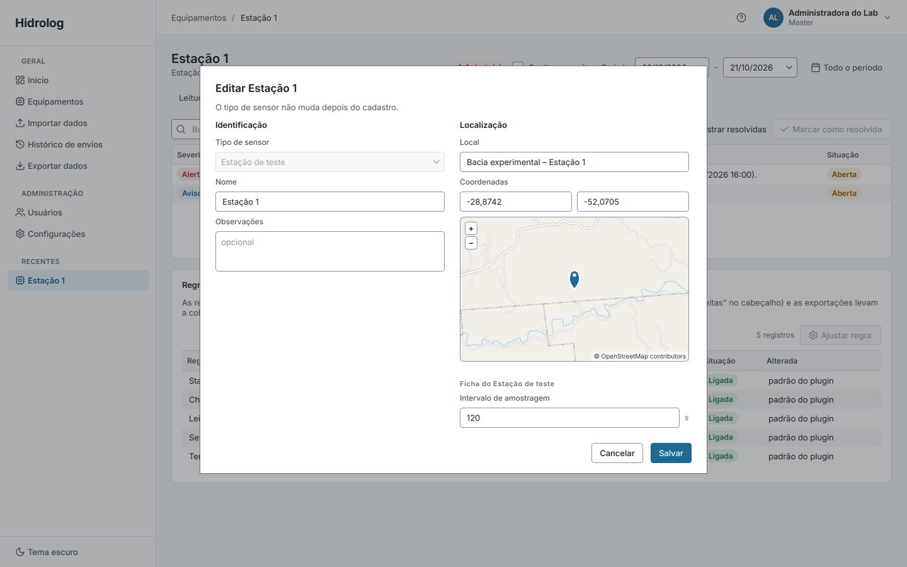
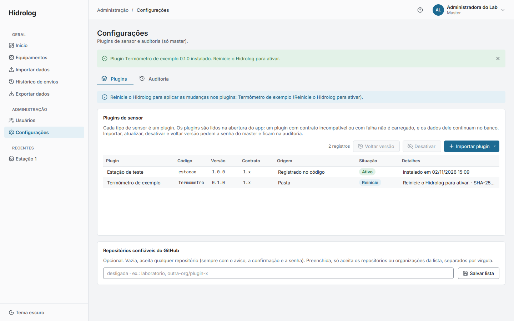
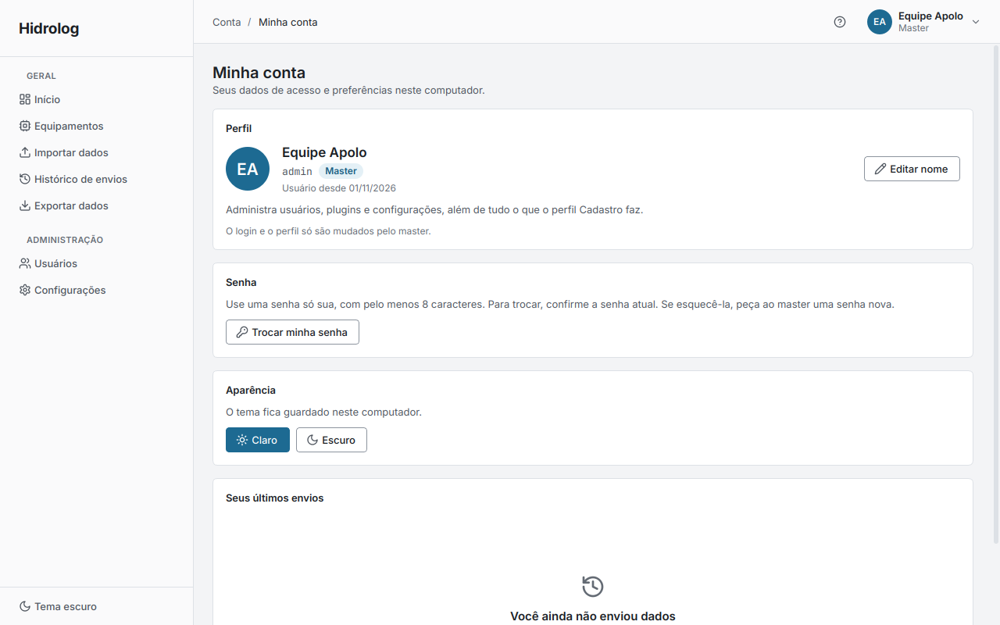
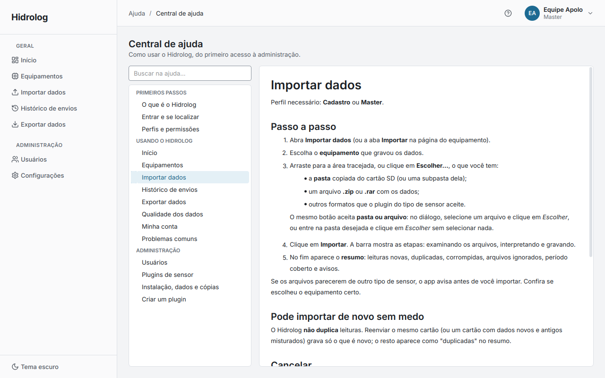

# frontend

O frontend é o app que as pessoas do laboratório abrem e usam: a janela com login, a barra
lateral, as páginas de equipamentos, importação, histórico e exportação, a administração de
usuários e plugins, a conta de cada um e a Central de ajuda. Ele é escrito em PySide6 (Qt para
Python) e roda num processo só, no computador do laboratório, sem servidor.

O frontend não guarda nem calcula dados por conta própria. Tudo o que ele mostra vem da camada de
serviço do backend (`app.servico`), chamada direto no mesmo processo, e tudo o que desenha usa o
tema e os componentes de `../design`. O papel dele é organizar a experiência: decidir o que cada
perfil vê, montar as páginas, rodar o trabalho pesado sem travar a janela e transformar os erros
do backend em mensagens claras.

## Estrutura

```
frontend/
├── hidrolog/                 pacote "hidrolog": o app
│   ├── __main__.py           python -m hidrolog
│   ├── aplicacao.py          a janela principal: tela de abertura, login, shell e main()
│   ├── nucleo/               o núcleo da interface, sem nenhum sensor
│   │   ├── shell.py          monta a barra lateral e registra as páginas
│   │   ├── contexto.py       a sessão: usuário logado, perfil, avisos de dados alterados
│   │   ├── tarefas.py        trabalho em segundo plano sem travar a janela
│   │   ├── registro.py       carrega as abas dos plugins e monta o contexto delas
│   │   ├── erros.py          erros do backend viram mensagens em português
│   │   ├── configuracao.py   pasta de dados, log e preferências da interface
│   │   └── telas/            uma página por arquivo
│   └── ajuda/                Central de ajuda: índice e tópicos em Markdown
├── tests/                    testes da interface (pytest-qt, sem tela)
├── ferramentas/
│   └── ponta_a_ponta.py      percorre o app inteiro e gera capturas de todas as telas
└── img/                      capturas usadas neste README
```

O pacote **`hidrolog`** começa em `aplicacao.py`, que cria a janela e decide o que mostrar: a tela
de abertura enquanto o banco abre, a tela que explica como criar o master quando ele ainda não
existe, o login e, depois de entrar, o shell com as páginas. O **`nucleo/`** contém o que é comum a
todas as páginas e, de propósito, nada que seja de um sensor; um teste garante que nenhum arquivo
dele importa código de plugin. Em **`telas/`** fica uma página por arquivo: Início, Equipamentos e
a página de cada equipamento, Importar dados, Histórico de envios, Exportar dados, Usuários,
Configurações (plugins e auditoria), Minha conta e a Central de ajuda, além de `comum.py` com as
peças que elas compartilham (a página com aviso e recarga, o formulário em diálogo).

A **Central de ajuda** fica em `hidrolog/ajuda/`: cada tópico é um arquivo Markdown em `topicos/`,
e `__init__.py` diz o título, o grupo e quais perfis veem cada um. Para acrescentar um tópico,
basta escrever o `.md` e uma linha no índice.

## Funcionamento

### Abertura, login e navegação

Ao abrir, o app mostra uma tela de abertura com um indicador enquanto o banco é aberto e migrado
em segundo plano. Se não houver nenhum master, aparece uma tela explicando o comando que o cria
(o app nunca cria o master sozinho). O login também confere a senha em segundo plano, com
"Verificando credenciais…" e os campos travados, e devolve uma mensagem única para usuário ou
senha errados, sem dizer qual dos dois.

Depois de entrar, o shell monta a barra lateral, que é fixa e não cresce com os sensores: Geral
(Início, Equipamentos, Importar, Histórico, Exportar), Administração (Usuários e Configurações,
só para o master) e Recentes (os últimos equipamentos abertos por aquela pessoa). O cabeçalho
mostra onde a pessoa está, o botão de ajuda e o menu da conta, com avatar, nome e perfil, que leva
a Minha conta e a Sair. O que um perfil não pode fazer não aparece; se mesmo assim o backend
recusar uma operação, a página mostra a mensagem dele. Se o usuário for desativado durante a
sessão, o app volta ao login com um aviso.



### Página do equipamento

Os dados de um sensor são vistos sempre a partir de um equipamento. A página dele tem um cabeçalho
com nome, tipo, local, o selo de qualidade, o filtro "Ocultar suspeitas" e o período, que vale
para todas as abas. As primeiras abas são as do plugin do tipo de sensor (gráficos e tabelas
específicos), seguidas das abas comuns a todos: Qualidade (ocorrências e regras ajustáveis),
Envios, Importar, Exportar e Cadastro. As abas do plugin recebem tudo pronto num contexto
(equipamento, período, usuário, as consultas do plugin, as leituras suspeitas, um jeito de rodar
trabalho em segundo plano) e não escolhem nada sozinhas; quando o período ou os dados mudam, o
núcleo pede que elas se atualizem.

Se o plugin do tipo não estiver carregado (desativado ou removido), a página continua abrindo com
as abas comuns e um aviso: os dados ficam consultáveis e exportáveis pelo CSV genérico, mas a
importação some, porque sem o plugin não há quem leia os arquivos. O mesmo cuidado vale para
equipamentos desativados, que saem da lista e da importação sem perder nada.

### Importação, cadastro e exportação

A importação aceita uma pasta, um `.zip` ou um `.rar`, arrastados para a área tracejada ou
escolhidos por um único botão que entende pasta ou arquivo. Antes de importar, o app pergunta aos
plugins se os arquivos parecem de outro tipo de sensor, para evitar o equipamento errado. A
importação roda em segundo plano com uma barra de etapas e pode ser cancelada sem gravar nada; no
fim aparece o resumo com leituras novas, duplicadas, corrompidas e ignoradas.



O cadastro de um equipamento é um formulário em duas colunas: à esquerda, a identificação; à
direita, a posição, escolhida clicando num mapa, e a ficha do plugin, um conjunto de campos que o
próprio plugin declara e que o formulário gera sozinho. A validação é sempre a do backend, e o
erro volta para o campo certo. Campos que o sensor informa nos próprios arquivos (como número de
série ou firmware) não são digitados: aparecem depois da primeira importação.



A exportação escolhe equipamento, período e um dos formatos que o plugin oferece, e gera o arquivo
em segundo plano. Configurações reúne o gerenciador de plugins (importar de pasta, `.zip` ou
GitHub, com a confirmação do que vai entrar e a senha do master, desativar, voltar versão) e a
auditoria.



### Conta do usuário e Central de ajuda

Em Minha conta cada pessoa vê o próprio perfil, troca o nome exibido e a própria senha (com a senha
atual), escolhe o tema claro ou escuro e vê os últimos envios que fez. A Central de ajuda mostra os
tópicos que o perfil pode ver, com busca que ignora acentos e links entre tópicos; os de
administração só aparecem para o master.

| Minha conta | Central de ajuda |
|---|---|
|  |  |

### Tarefas em segundo plano

Qualquer coisa que possa demorar (abrir o banco, entrar, carregar os dados de um período,
importar, exportar, preparar um plugin) roda em threads de trabalho por `nucleo/tarefas.py`,
enquanto a janela mostra um indicador de carregamento. A thread de trabalho nunca toca num objeto
do Qt: o resultado, o erro e o progresso voltam por um único objeto despachante, que entrega tudo
na thread da interface. Pelo mesmo motivo, a coleta de lixo do Python roda num timer da interface
e só entre tarefas, porque rodando no meio de uma consulta ao banco ela chegava a corromper a
memória e derrubar o app.

### Erros, log e preferências

As exceções do backend são traduzidas para mensagens em português, com acentos, em `erros.py`; os
detalhes técnicos vão para o arquivo de log (`hidrolog.log`, na pasta de dados), e a tela mostra
só o que a pessoa precisa saber. As preferências da interface, como o tema, ficam em
`hidrolog-interface.ini`, na mesma pasta.

## Integração com o sistema

O frontend é a ponta do sistema: nada depende dele. Ele depende do backend (`app.servico` e o
contrato `hidrolog_nucleo`) e do design (`design.tema` e `design.componentes`). Os plugins entram
nele de um jeito só: pelo módulo de interface que declaram (`Plugin.interface`), com uma lista
`ABAS`, que `nucleo/registro.py` importa sob demanda na primeira vez que alguém abre um
equipamento daquele tipo. Um plugin com a interface quebrada não derruba o app: o erro vai para o
log e o equipamento fica só com as abas comuns.

## Execução e testes

```bash
cd frontend
python3 -m venv venv
venv/bin/pip install -r requirements.txt          # o app, o backend e o design, editáveis
venv/bin/python -m hidrolog                       # --tema escuro para abrir no tema escuro
venv/bin/python -m pytest                         # testes, sem tela
QT_QPA_PLATFORM=offscreen venv/bin/python ferramentas/ponta_a_ponta.py   # o app inteiro + capturas
```

Os testes usam pytest-qt sem tela, um banco temporário por teste, o sensor fictício do backend e o
plugin de exemplo, e reprovam se o app registrar qualquer erro no log. Eles cobrem do login à
Central de ajuda, passando por cada página, pelos perfis, pela importação com cancelamento, pelo
formulário gerado da ficha, pela qualidade, pelo gerenciador de plugins e pelos casos sem plugin.
A ferramenta `ponta_a_ponta.py` faz o caminho de uma pessoa de verdade num banco novo (cria o
master pela linha de comando, cadastra usuários e equipamentos pela tela, importa, reimporta,
exporta, instala o plugin de exemplo, reinicia e o desativa) e grava capturas de todas as telas
nos dois temas em `capturas/`.
